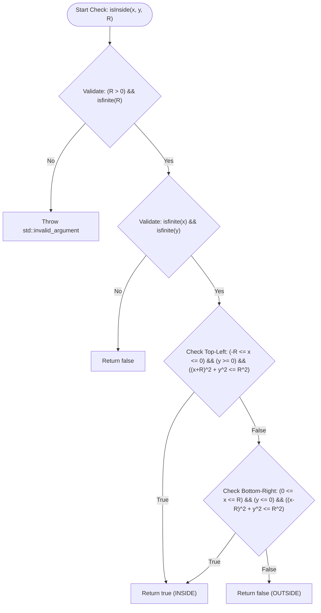
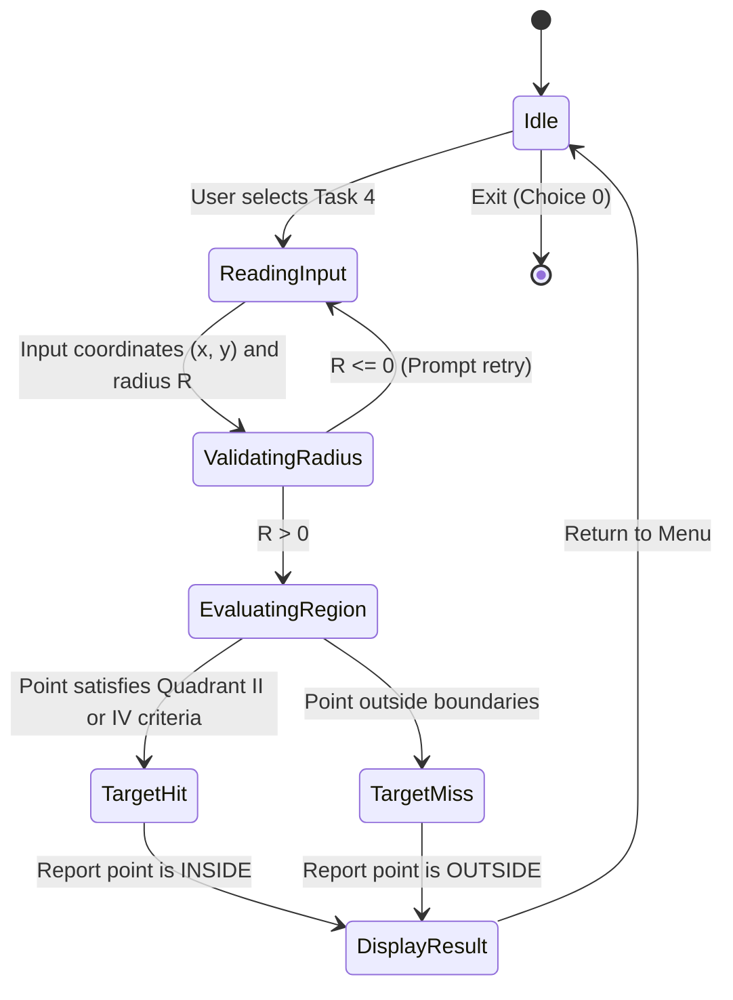
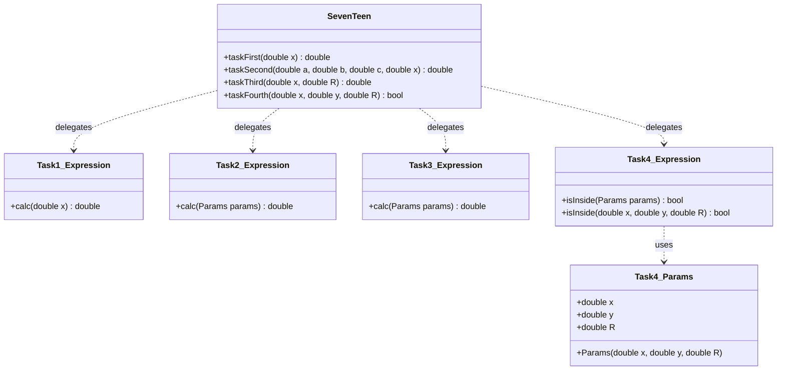

# Laboratory Work 3: Branching & Geometry Algorithms (Variant 17)

This module implements algorithmic branching statements, piecewise functions, parametric calculations, and 2D geometric target determination.

---

## 1. Task Descriptions

### Task 1: Piecewise Function of One Variable
Evaluates a piecewise function $f(x)$ added to $x^2 + 1$:
$$y = x^2 + 1 + f(x)$$
Where $f(x)$ branches based on intervals of $x$:
- $x < 4$: Polynomial evaluation
- $4 \le x < 7$: Trigonometric and logarithmic expression
- $x \ge 7$: Exponential and logarithmic expression

### Task 2: Parametric Function Evaluation
Evaluates piecewise function $F(a, b, c, x)$ using two distinct branching methods:
- **Branch A**: $F = a x^2 - c x + b$, if $(x + 10 < 0) \land (b \neq 0)$
- **Branch B**: $F = \frac{x - a}{x - c}$, if $(x + 10 > 0) \land (b = 0)$ (requires $x \neq c$)
- **Branch C**: $F = \frac{-x}{a - c}$, in all other cases (requires $a \neq c$)

Implemented via:
1. **Method 1 (Short Form)**: Uses only single `if` statements without `else`. Sets Branch C as default, and conditionally overrides with Branch A or B.
2. **Method 2 (Full Form)**: Uses nested `if-else` branching with independent division-by-zero checks.


### Task 3: Piecewise Chart Function
Calculates coordinates along a composite curve defined by straight segments and circular arcs based on radius $R$ and argument $x$.

### Task 4: Point Inclusion in Shaded Region
Determines whether a point $(x, y)$ falls inside or on the boundary of the shaded area for a user-specified radius parameter $R > 0$.

#### Mathematical Model
The shaded region exhibits 180° rotational point symmetry with respect to the coordinate origin $(0, 0)$ and is composed of two symmetrical sub-regions:

1. **Second Quadrant (Top-Left Region):**
   - Bounded horizontally by: $-R \le x \le 0$
   - Bounded vertically by: $0 \le y \le R$
   - Bounded by the quarter-circle arc centered at $(-R, 0)$ with radius $R$:
     $$(x + R)^2 + y^2 \le R^2$$

2. **Fourth Quadrant (Bottom-Right Region):**
   - Bounded horizontally by: $0 \le x \le R$
   - Bounded vertically by: $-R \le y \le 0$
   - Bounded by the quarter-circle arc centered at $(R, 0)$ with radius $R$:
     $$(x - R)^2 + y^2 \le R^2$$

A point $(x, y)$ is **inside** the target area if and only if it satisfies either condition:
$$\text{Inside} \iff \Big(-R \le x \le 0 \land y \ge 0 \land (x + R)^2 + y^2 \le R^2\Big) \lor \Big(0 \le x \le R \land y \le 0 \land (x - R)^2 + y^2 \le R^2\Big)$$

---

## 2. Execution Guide

### Requirements
- C++17 compatible compiler (e.g., GCC 9+, Clang 10+)
- CMake 3.20 or newer

### Building the Project
```bash
cmake -B build -S .
cmake --build build
```

### Running the Interactive Console Program
```bash
./build/bin/Lb3
```

### Running the Unit Tests
Execute the automated test suite via CTest:
```bash
ctest --test-dir build --output-on-failure
```
Or run the test executable directly:
```bash
./build/bin/Lb3_tests
```

---

## 3. Mermaid Diagrams

### Flowchart: Algorithmic Execution and Branching Logic


### UML Activity Diagram: Execution Flow and State Changes


### Structural Diagram: Architecture and Components

