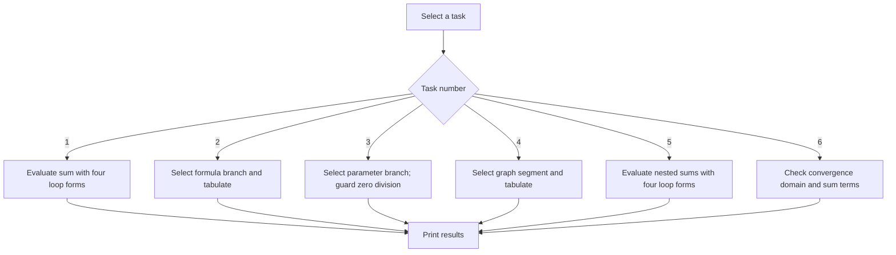
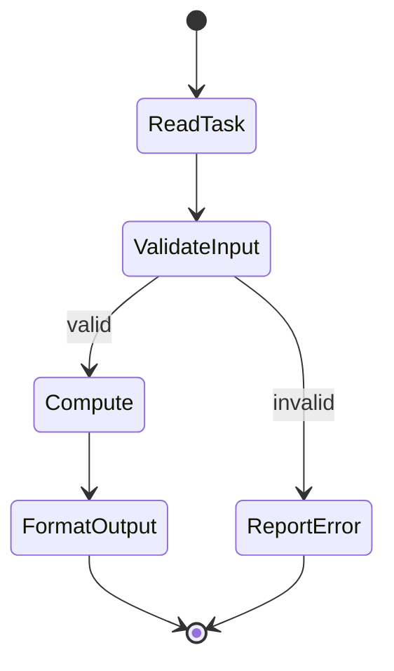
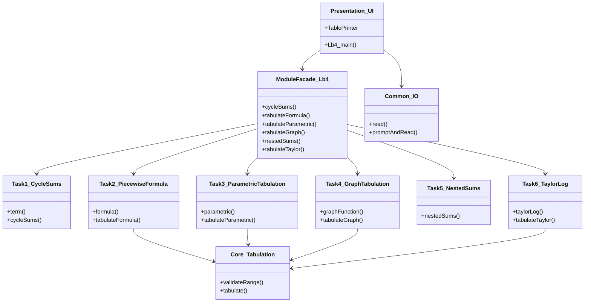

# Lab 4 — Iteration and tabulation

This module implements cycle-based summation, three piecewise/tabulated functions, four nested-loop variants, and a logarithm Taylor-series table. Task 4.5 is intentionally excluded because its assignment file does not specify the target region.

## Build, run, test

From the repository root:

```sh
cmake -B build -S .
cmake --build build --target Lb4 Lb4_tests
./build/bin/Lb4
ctest --test-dir build --output-on-failure -R Lb4
```

The executable first asks for task number. Inputs are then read in the order stated in the corresponding task file; task 2 takes `start end step`, task 3 takes `a b c start end step`, task 4 takes `R start end step`, and task 6 takes `start end step epsilon`.

## Flowchart



## Activity diagram



## Structure


