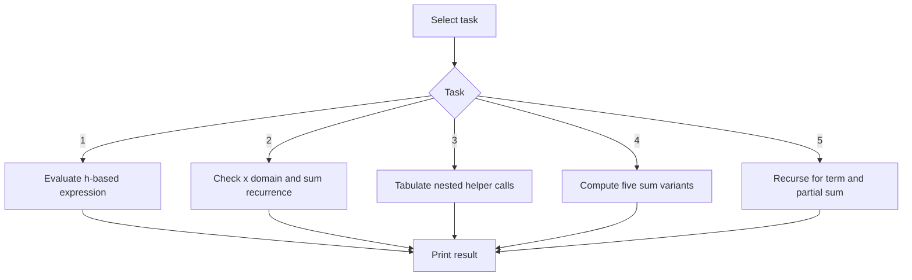
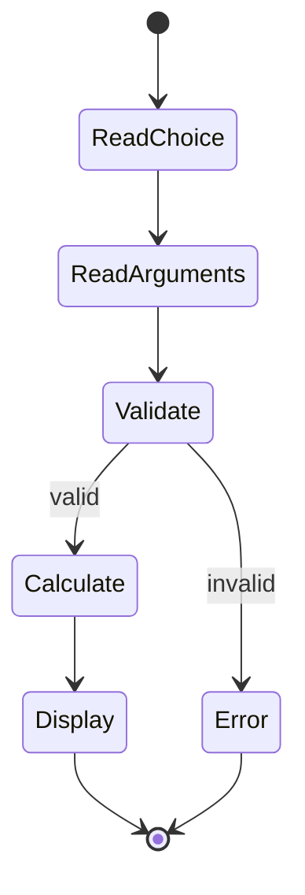
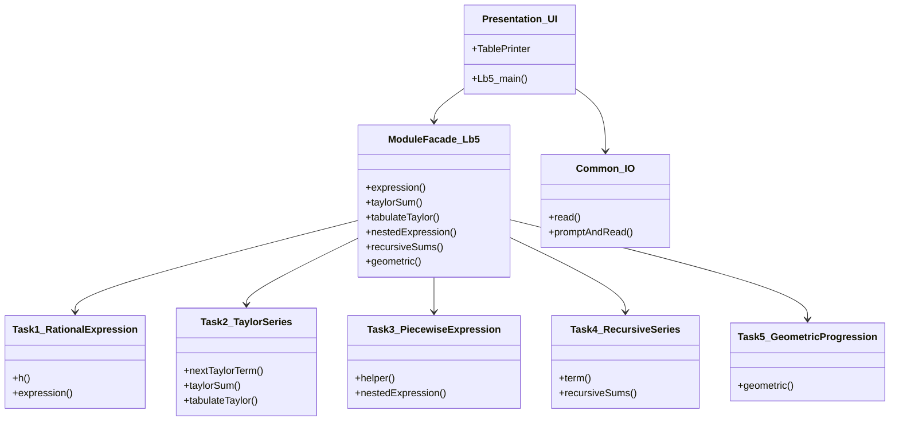

# Lab 5 — Functions and recursion

Implements the parameterized expression, logarithm Taylor series, the helper-function table, five equivalent recursive/iterative sums, and geometric-progression recursion.

## Build, run, test

```sh
cmake -B build -S .
cmake --build build --target Lb5 Lb5_tests
./build/bin/Lb5
ctest --test-dir build --output-on-failure -R Lb5
```

Choose a task in the console and enter the values described in `.local/tasks/5.*`.

The 5.3 task sheet's stated approximation `h(0.5) ≈ 1.2553` conflicts with its explicit six-term series and recurrence. This implementation follows the formula; those terms give `h(0.5) ≈ 1.2605918365`.

## Flowchart



## Activity diagram



## Structure


