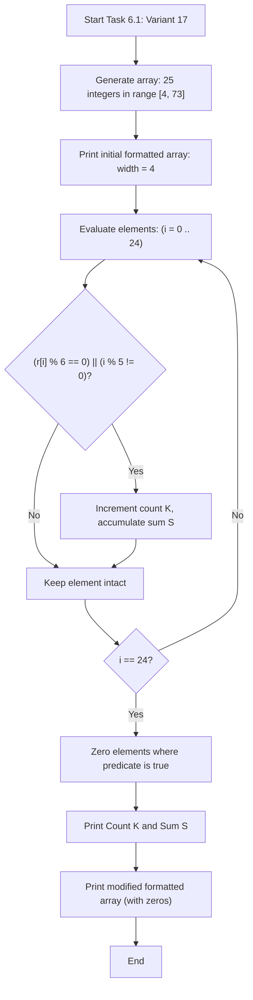
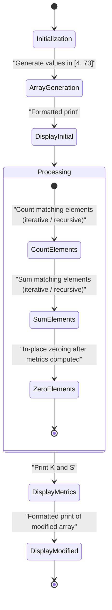
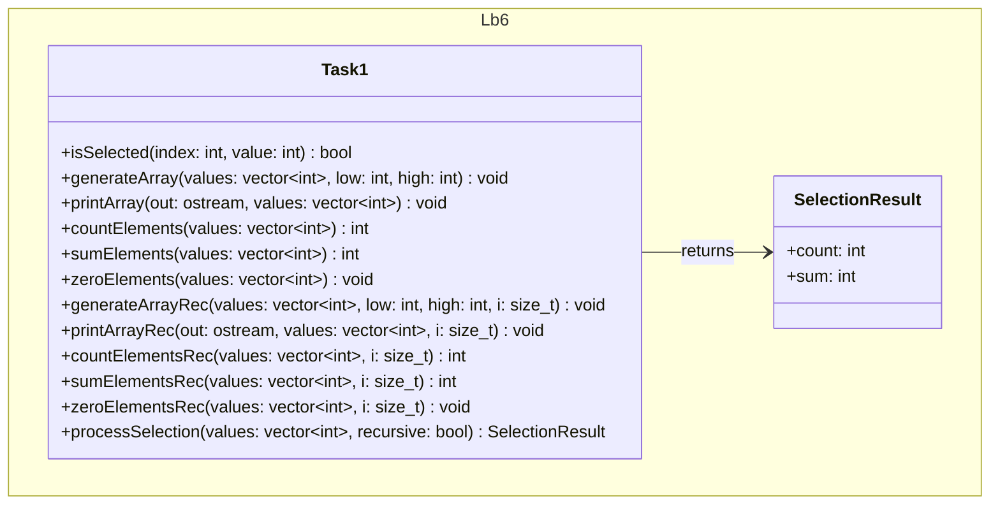

# Lab 6 — One-Dimensional Arrays (Modern C++)

Modular C++17 implementation of one-dimensional array algorithms using iterative and recursive techniques.

## Subtasks Overview

1. **Task 6.1 (Variant 17): Array Selection, Counting, Summation, and Zeroing**
   - **Domain:** Pseudo-random integers in $[4, 73]$ inclusive, vector dimension $n = 25$.
   - **Criterion:** $(r_i \bmod 6 = 0) \lor (i \bmod 5 \neq 0)$.
   - **Invariants:**
     - $20 \le K \le 25$ matching elements.
     - $80 \le S \le 1825$ cumulative sum.
     - Modifications occur strictly after calculation: $\text{Generate} \to \text{Print} \to (\text{Count}, \text{Sum}) \to \text{Zero} \to \text{Print}$.
   - **Decomposition (Single Responsibility):** Separate functions for iterative (`generateArray`, `printArray`, `countElements`, `sumElements`, `zeroElements`) and recursive (`generateArrayRec`, `printArrayRec`, `countElementsRec`, `sumElementsRec`, `zeroElementsRec`) approaches.
2. **Task 6.2:** Search for the first index of the maximum even element.
3. **Task 6.3:** Array input overloads and template functions.
4. **Task 6.4:** Dynamic array processing: positive count, sum after last zero, and stable partition around value $2.0$.

## Execution Guide

Configure, compile, and run the module and test suite via CMake and CTest:

```bash
# Configure build directory
cmake -B build -S .

# Build executable and test suite
cmake --build build --target Lb6 Lb6_tests

# Run interactive console application
./build/bin/Lb6

# Execute automated tests
ctest --test-dir build --output-on-failure -R Lb6
```

## Diagrams (Mermaid.js)

### Algorithmic Flowchart (`flowchart TD`)



### Execution Flow / Activity Diagram (`stateDiagram-v2`)



### Module Architecture Diagram (`classDiagram`)


