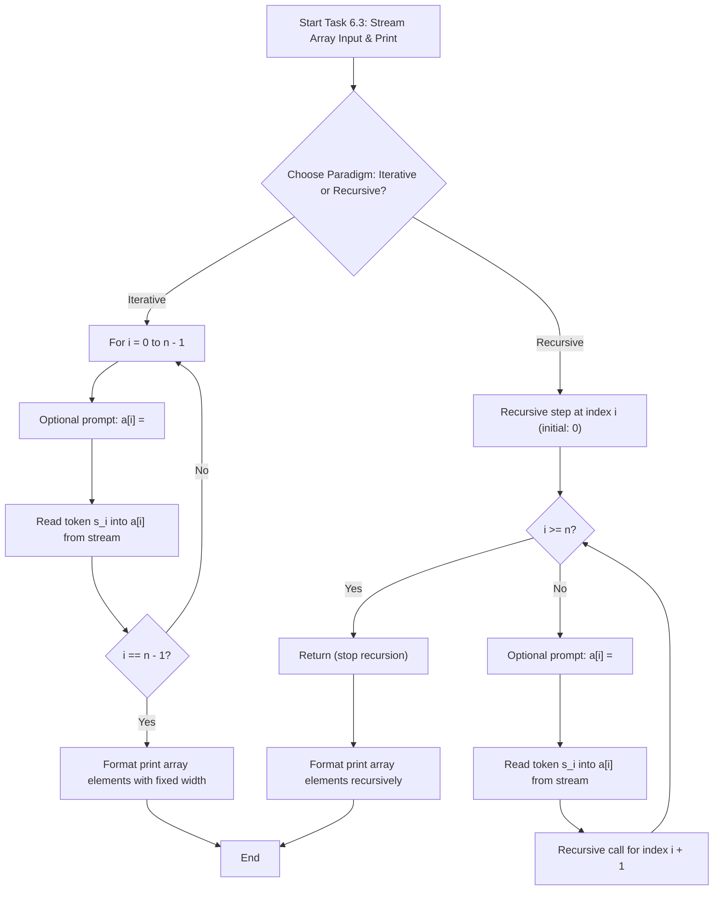
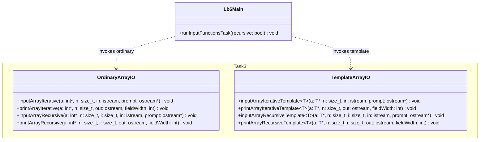

# Lab 6 — One-Dimensional Arrays (Modern C++)

Modular C++17 implementation of one-dimensional array algorithms using iterative and recursive techniques.

## Subtasks Overview

1. **Task 6.1 (Variant 17): Array Selection, Counting, Summation, and Zeroing**
   - **Domain:** Pseudo-random integers in $[4, 73]$ inclusive, vector dimension $n = 25$.
   - **Criterion:** $(r_i \bmod 6 = 0) \lor (i \bmod 5 \neq 0)$.
   - **Invariants:**
     - $20 \le K \le 25$ matching elements.
     - $80 \le S \le 1825$ cumulative sum.
     - Sequence: $\text{Generate} \to \text{Print} \to (\text{Count}, \text{Sum}) \to \text{Zero} \to \text{Print}$.
   - **Decomposition:** `generateArray`, `printArray`, `countElements`, `sumElements`, `zeroElements` (with recursive counterparts `generateArrayRec`, `printArrayRec`, `countElementsRec`, `sumElementsRec`, `zeroElementsRec`).

2. **Task 6.2 (Variant 17): Search for the Index of the Maximum Even Element**
   - **Domain:** One-dimensional array $a = (a_0, a_1, \dots, a_{n-1})$ of arbitrary dimension $n \ge 1$ with $a_i \in [-50, 50]$.
   - **Evenness Predicate:** $P(x) \iff (x \bmod 2 = 0)$ (correctly handles negative values and zero: $0 \bmod 2 = 0$).
   - **Solution Existence & Tie-Breaking:**
     - If no even numbers exist ($I_{\text{even}} = \varnothing$), returns sentinel value $k^* = -1$.
     - If duplicates of the maximum even value exist, returns the first occurrence (smallest index): $k^* = \min \{ i \in I_{\text{even}} \mid a_i = \max_{j \in I_{\text{even}}} a_j \}$.
   - **Decomposition:** `initArrayIterative`, `printArrayIterative`, `findMaxEvenIndexIterative`, `initArrayRecursive`, `printArrayRecursive`, `findMaxEvenIndexRecursive`.

3. **Task 6.3: Keyboard & Stream Array Input via Ordinary and Function Templates**
   - **Domain:** Sequential reading and formatted printing of 1D arrays of size $n$ from input streams (`std::istream`, with default `std::cin`).
   - **Dual Typification:**
     - **Part A (Ordinary Functions):** Type-specialized for `int`: `inputArrayIterative`, `printArrayIterative`, `inputArrayRecursive`, `printArrayRecursive`.
     - **Part B (Function Templates):** Parametric polymorphism for generic type $T$ (`int`, `double`, `std::string`): `inputArrayIterativeTemplate<T>`, `printArrayIterativeTemplate<T>`, `inputArrayRecursiveTemplate<T>`, `printArrayRecursiveTemplate<T>`.
   - **Deterministic Unit Testing:** Supports dependency injection of streams (`std::istringstream` and `std::ostringstream`) to verify automated execution without interactive user intervention.

4. **Task 6.4:** Dynamic array processing: positive count, sum after last zero, and stable partition around value $2.0$.

## Execution Guide

Configure, compile, and run the module and test suite via CMake and CTest:

```bash
# Configure build directory
cmake -B build -S .

# Build executable and test suite
cmake --build build --target Lb6 Lb6_tests

# Run interactive console application
./build/bin/Lb6

# Execute automated tests
ctest --test-dir build --output-on-failure -R Lb6
```

## Diagrams (Mermaid.js)

### Algorithmic Flowchart (`flowchart TD`)



### Execution Flow / Activity Diagram (`stateDiagram-v2`)

```mermaid
stateDiagram-v2
    [*] --> Setup
    Setup --> StreamInjection: "Inject input stream (std::cin or std::istringstream)"
    StreamInjection --> InputPhase
    
    state InputPhase {
        [*] --> CheckBoundary: "Check index i < n"
        CheckBoundary --> ReadToken: "Stream extraction into a[i]"
        ReadToken --> AdvanceIndex: "Increment index (loop or tail call)"
        AdvanceIndex --> CheckBoundary
        CheckBoundary --> [*]: "i >= n"
    }
    
    InputPhase --> FormatPrintPhase: "Pass populated array to output formatter"
    
    state FormatPrintPhase {
        [*] --> FormatElement: "std::setw(width) << a[i]"
        FormatElement --> NextPrint: "Advance to i + 1"
        NextPrint --> FormatElement: "i < n"
        NextPrint --> EmitNewline: "i >= n -> output newline"
        EmitNewline --> [*]
    }
    
    FormatPrintPhase --> [*]
```

### Module Architecture Diagram (`classDiagram`)


