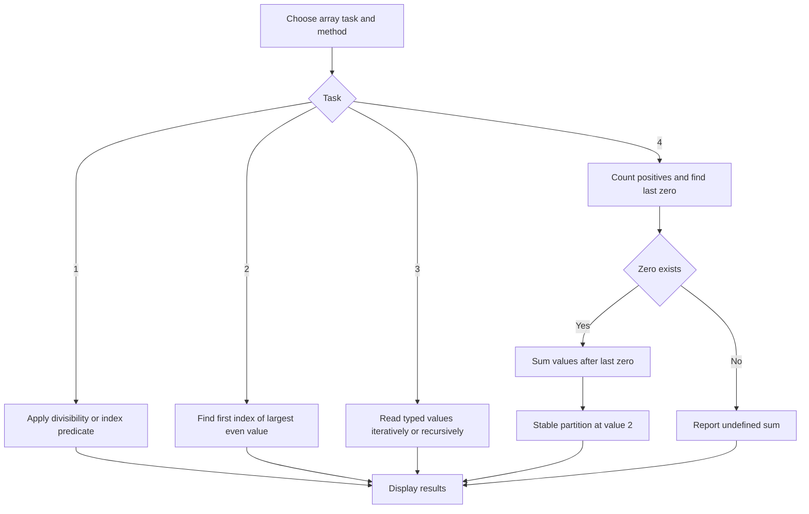
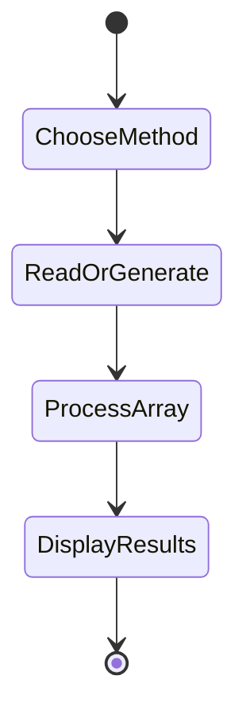
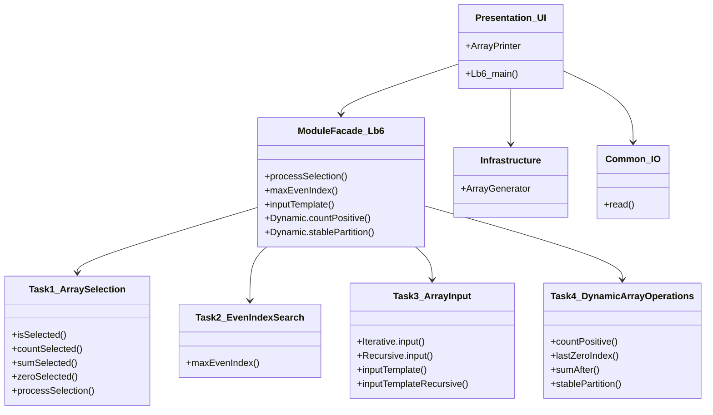

# Lab 6 — One-dimensional arrays

Contains iterative and recursive solutions for selection/count/sum/zeroing, maximum-even search, array input overloads/templates, and dynamic-array statistics with stable partitioning.

## Build, run, test

```sh
cmake -B build -S .
cmake --build build --target Lb6 Lb6_tests
./build/bin/Lb6
ctest --test-dir build --output-on-failure -R Lb6
```

Choose a task and then `0` for iterative or `1` for recursive. Randomized examples use the current time as their seed; tests use deterministic fixtures.

## Flowchart



## Activity diagram



## Structure


