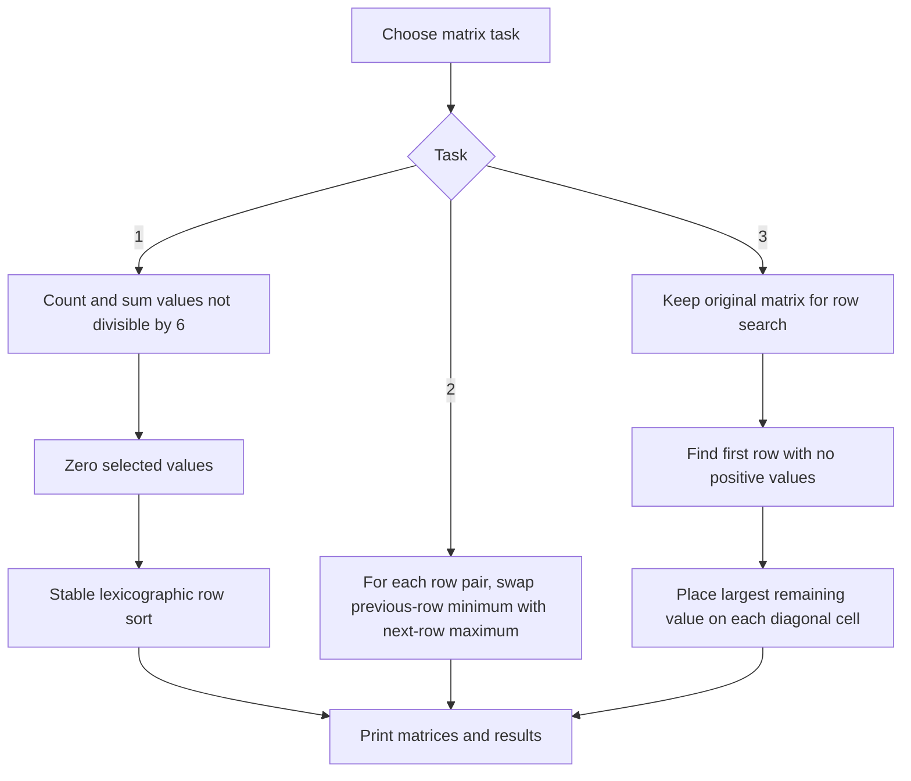
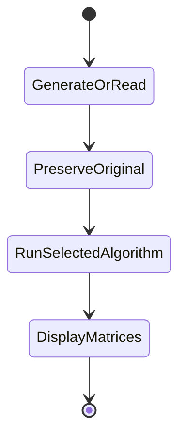
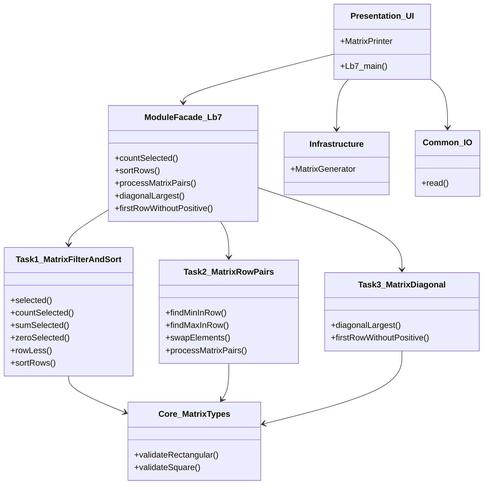

# Lab 7 — Matrix processing

Includes matrix filtering by the non-multiple-of-six predicate, stable row sorting by columns 1/2/4, paired row-extrema swaps, largest-value placement on the main diagonal, and first nonpositive-row search. Both iterative and recursive implementations are available where required.

## Build, run, test

```sh
cmake -B build -S .
cmake --build build --target Lb7 Lb7_tests
./build/bin/Lb7
ctest --test-dir build --output-on-failure -R Lb7
```

Choose the task number. Tasks 1 and 3 also ask for the method (`0` iterative, `1` recursive); task 2 asks for row and column counts. Random examples use the current time as a seed.

## Flowchart



## Activity diagram



## Structure


